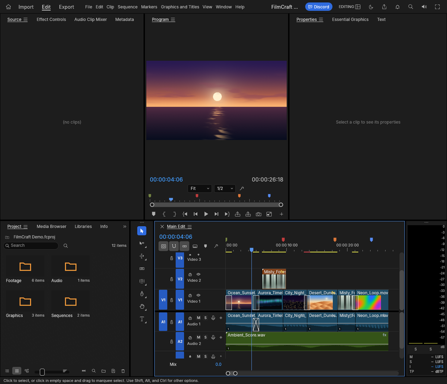

# FilmCraft Localhost

Instalador e pacote para executar localmente no Termux a versão web **FilmCraft 0.8.0**. Este repositório é um empacotamento comunitário e **não é oficial nem afiliado ao projeto FilmCraft**.



## Instalação simples no Android/Termux

1. Baixe `instalar-filmcraft-termux.sh` deste repositório para a pasta **Downloads** do Android.
2. No Termux, autorize o acesso aos arquivos (necessário apenas uma vez):

   ```bash
   termux-setup-storage
   ```

3. Execute o instalador:

   ```bash
   bash ~/storage/downloads/instalar-filmcraft-termux.sh
   ```

O script instala `python` e `unzip` pelo gerenciador de pacotes do Termux se estiverem faltando. Se o pacote corrigido não estiver junto do script nem nas pastas usuais, ele baixa automaticamente `filmcraft-web-0.8.0-webgl-fallback.zip`, extrai os arquivos e inicia o servidor local. O pacote tenta WebGL2 automaticamente se a inicialização WebGPU falhar por um limite de textura rejeitado. Não é necessário baixar ou extrair o ZIP manualmente.

O servidor escuta apenas em `localhost` no próprio aparelho. Mantenha o Termux aberto enquanto usa o app; pressione `Ctrl+C` para encerrar.

## Downloads incluídos

- `instalar-filmcraft-termux.sh` — instalador/launcher automático do Termux.
- `filmcraft-web-0.8.0-webgl-fallback.zip` — pacote recomendado; tenta WebGL2 automaticamente se a inicialização WebGPU falhar por limite de textura.
- `filmcraft-web-0.8.0.zip` — ZIP original do release upstream v0.8.0.
- `captura-interface.webp` — captura da interface do FilmCraft.

O pacote corrigido é baseado no [release v0.8.0 de storytold/filmcraft](https://github.com/storytold/filmcraft/releases/tag/v0.8.0). O ajuste adicional é reproduzível no arquivo `patches/webgpu-limit-webgl-fallback.patch`.

## Termux:X11 (opcional)

A opção `--x11` exige o APK oficial do Termux:X11 e um navegador gráfico instalado. No Termux, instale os componentes:

```bash
pkg install x11-repo termux-x11-nightly chromium
```

Depois, execute:

```bash
bash ~/storage/downloads/instalar-filmcraft-termux.sh --x11
```
